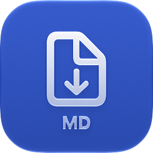
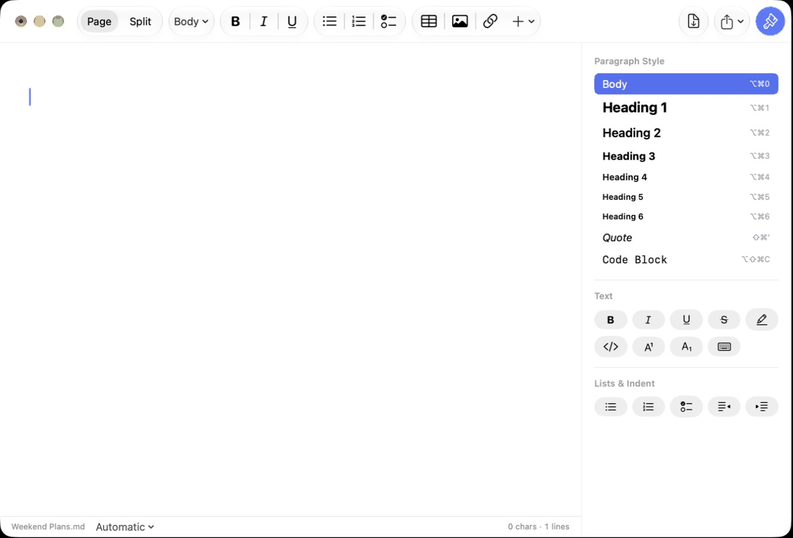
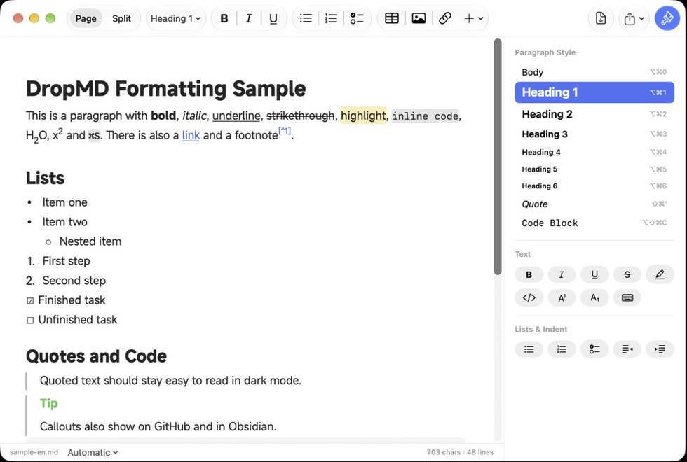
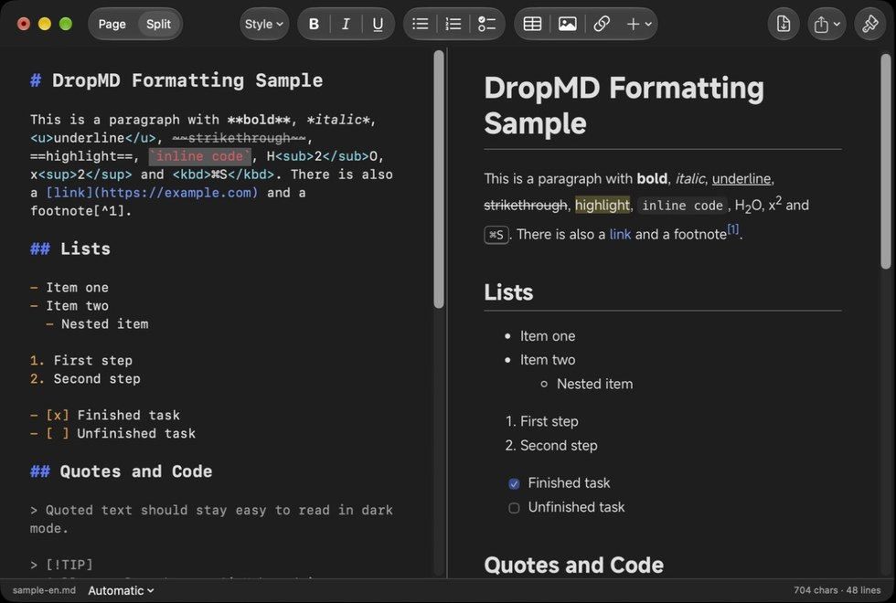

<p align="right">🌐 <a href="README.md">简体中文</a> | <b>English</b></p>

<div align="center">



# DropMD

**An offline Markdown editor for the Mac**

It also converts Word, Excel, PowerPoint, PDF and other files to Markdown, all on your own Mac

[](#-install) [](docs/发行说明.md) [](macos) [](LICENSE)

<br>

📦 [**Install**](#-install) &nbsp;·&nbsp; ✨ [Features](#-features) &nbsp;·&nbsp; 🔄 [File conversion](#-file-conversion) &nbsp;·&nbsp; 🔒 [Privacy](#-privacy) &nbsp;·&nbsp; 🛠️ [Build from source](#️-build-from-source) &nbsp;·&nbsp; 📖 [User Guide](docs/User%20Guide.md)

<br>



</div>

> [!NOTE]
> DropMD is in beta. Please report problems in Issues.
> The interface follows your Mac's language: English or Chinese.

## ✨ Features

<p align="center"> </p>

- **Page view**: edit the formatted document directly, like in Pages or Word. You don't need to know Markdown, and the file is still saved as standard Markdown
- **Split view**: Markdown source on the left, live preview on the right, scrolling together
- **Everyday formatting**: headings, bold, italic, underline, strikethrough, highlight, lists, checklists, tables, images, links, code blocks
- **More formatting**: callouts (`> [!NOTE]`), collapsible sections, footnotes, math formulas, superscript / subscript, keyboard keys
- **Chinese, Japanese and Korean text**: choose the document language so characters use the right glyph shapes, on screen and in exported files
- **A native Mac app**: built with SwiftUI, uses Liquid Glass on macOS 26 and later, with colors designed for both light and dark mode
- **Export**: PDF and HTML; auto save and version history
- **Software updates**: check for new versions in the app; downloads are checked for integrity, then click Restart to finish

## 📦 Install

1. Download `DropMD-macOS-AppleSilicon.dmg` from [Releases](../../releases)
2. Open it and drag **DropMD** to Applications
3. macOS blocks it the first time you open it. Open it once as described below and you won't be asked again

For Macs with Apple silicon, macOS 14 or later. Later versions can be installed from inside the app (**DropMD → Check for Updates…**).

### First launch: “Apple could not verify…”

DropMD is free, open source software and isn't signed with a paid Apple developer certificate ($99 a year), so the first time you open it macOS says “Apple could not verify ‘DropMD’ is free of malware”. This doesn't mean anything is wrong with it: all the source code is in this repository, the downloads are built in public by GitHub Actions, and every release comes with a `.sha256` checksum.

**Option 1: allow it in System Settings (recommended)**

1. Double-click DropMD. When the message appears, click **Done** (not “Move to Trash”)
2. Open **System Settings → Privacy & Security** and scroll to the bottom
3. Under “Security” you'll see “‘DropMD’ was blocked”. Click **Open Anyway** next to it and enter your login password
4. When the message appears again, click **Open Anyway**

**Option 2: run one command in Terminal**

```bash
xattr -dr com.apple.quarantine /Applications/DropMD.app
```

This only removes the mark macOS puts on files downloaded from the internet. After that, DropMD opens with a double-click.

> [!NOTE]
> You only need to do this once. New versions installed from inside the app aren't blocked.


## 🔄 File conversion

Choose **File → Convert Files to Markdown…**, then drag in files or whole folders. They are converted in one go, with a result for each file.

| Mode | Good for | Engine |
| --- | --- | --- |
| Fast | Word, Excel, PowerPoint, HTML, text-based PDF | [MarkItDown](https://github.com/microsoft/markitdown) |
| Word, better layout | Word documents whose layout and images should be kept | [Pandoc](https://pandoc.org/) |
| High Accuracy | Papers, tables, formulas, scanned PDFs | [Docling](https://github.com/docling-project/docling) + OCR (RapidOCR or Apple Vision) |

You don't need to install Python: the conversion engine is built into the app.

## 🔒 Privacy

- All editing and conversion happen on this Mac; your files are never uploaded
- Goes online only with your consent: to download the High Accuracy recognition models and to check for updates
- No analytics, no ads, and your original files are never changed

## 🛠️ Build from source

You need a Mac with Apple silicon, Python 3.12 and Xcode 26 or later.

```bash
pip install -r requirements.txt -r requirements-build.txt
pyinstaller packaging/dropmd.spec --noconfirm
tools/fetch_fonts.sh      # download the MiSans font (not stored in this repository)
macos/build_app.sh        # outputs dist/DropMD.app
```

```bash
tools/test_codec.sh       # Markdown round-trip tests
tools/test_editor.sh      # Page view editing tests
tools/test_update.sh      # software update install tests
tools/test_l10n.sh        # checks every interface text has an English translation
```

<details>
<summary>Project layout</summary>

```
macos/                 Interface (Swift / SwiftUI)
  Sources/DropMD/      Editor, converter window, software updates
  Resources/preview/   Split view preview (markdown-it, KaTeX; bundled, nothing loaded from the web)
  Resources/en.lproj/  English interface text (ja.lproj: Japanese)
  Resources/AppIcon.icon  App icon (Icon Composer format, adapts to light / dark)
  build_app.sh         Assembles DropMD.app
src/dropmd/            Conversion engine (Python: MarkItDown / Pandoc / Docling)
tools/                 Test scripts
.github/workflows/     Builds the .dmg, self-tests, releases
docs/                  User guides, release notes, dependency list
```

The Swift interface hands conversions to the local engine inside the app (a child process that exchanges JSON over standard input and output). For dependencies and versions, see the [dependency list](docs/依赖清单.md) (in Chinese).

</details>

## 📄 License

[MIT](LICENSE) © 2026 DropMD contributors. Third-party licenses are in [THIRD_PARTY_LICENSES.md](THIRD_PARTY_LICENSES.md), and in the app under **Help → Open Source Licenses**.
