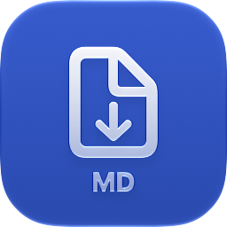
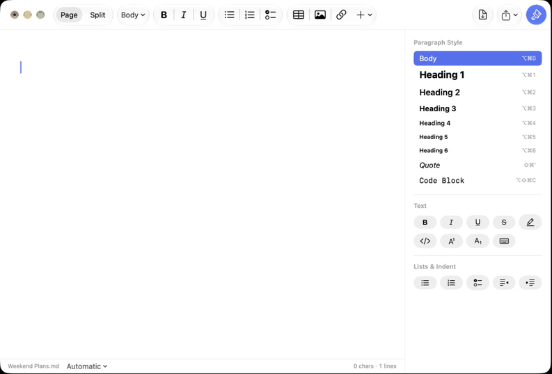
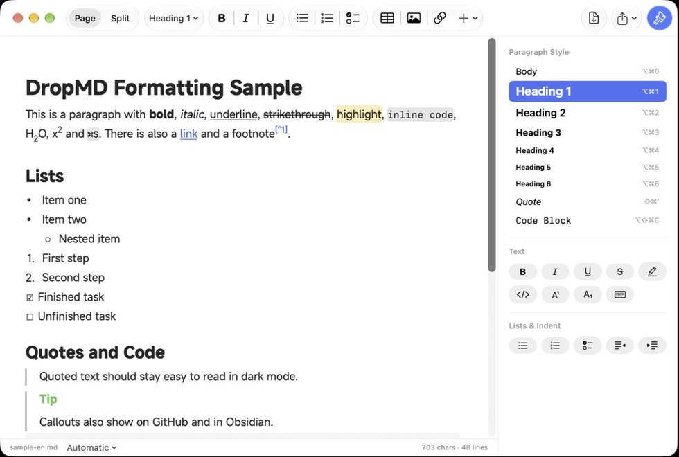
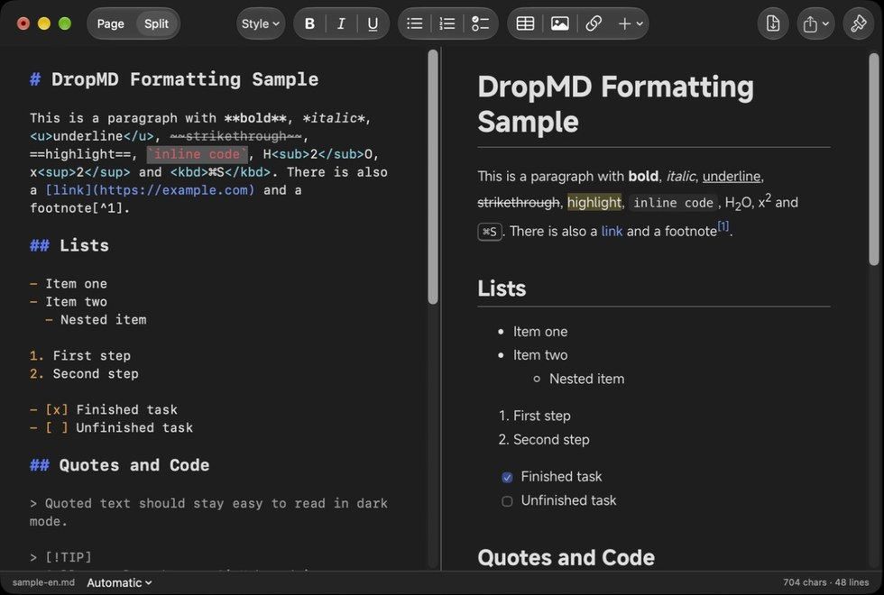

<p align="right">🌐 <a href="README.md">简体中文</a> | <a href="README.en.md">English</a> | <b>日本語</b></p>

<div align="center">



# DropMD

**Mac 用のオフライン Markdown エディタ**

Word、Excel、PowerPoint、PDF などのファイルを Markdown に変換することもできます。すべてお使いの Mac 上で処理します

[](#-インストール) [](docs/发行说明.md) [](macos) [](LICENSE)

<br>

📦 [**インストール**](#-インストール) &nbsp;·&nbsp; ✨ [機能](#-機能) &nbsp;·&nbsp; 🔄 [ファイル変換](#-ファイル変換) &nbsp;·&nbsp; 🔒 [プライバシー](#-プライバシー) &nbsp;·&nbsp; 🛠️ [ソースからビルド](#️-ソースからビルド) &nbsp;·&nbsp; 📖 [ユーザガイド（英語）](docs/User%20Guide.md)

<br>



</div>

> [!NOTE]
> 問題があれば Issues で報告してください。
> 表示言語は Mac の言語設定に合わせて、日本語・英語・中国語（簡体字 / 繁体字）から自動で選ばれます。「DropMD → 設定…」で個別に選ぶこともできます。

## ✨ 機能

<p align="center"> </p>

- **ページ表示**：Pages や Word のように、書式が付いた状態のまま直接編集できます。Markdown を知らなくても使え、ファイルは標準の Markdown で保存されます
- **分割表示**：左に Markdown ソース、右にリアルタイムのプレビュー。スクロールも連動します
- **よく使う書式**：見出し、太字、斜体、下線、取り消し線、ハイライト、リスト、チェックリスト、表、画像、リンク、コードブロック
- **その他の書式**：コールアウト（`> [!NOTE]`）、折りたたみセクション、脚注、数式、上付き / 下付き、キーボードのキー
- **日本語・中国語・韓国語**：書類の言語を選ぶと、漢字がその言語の字形で表示されます（画面上でも、書き出したファイルでも）
- **クイックルック**：Finder で .md ファイルを選んでスペースキーを押すと、開かずに書式付きで確認できます
- **Mac ネイティブのアプリ**：SwiftUI で作られ、macOS 26 以降では Liquid Glass を使用。ライト / ダークの両方に合わせた配色です
- **書き出し**：PDF と HTML。自動保存とバージョン履歴にも対応
- **ソフトウェア・アップデート**：アプリ内で新しいバージョンを確認。ダウンロードしたファイルの完全性を確認したうえで、“再起動”を押すだけで更新できます

## 📦 インストール

1. [Releases](../../releases) から `DropMD-macOS-AppleSilicon.dmg` をダウンロードします
2. 開いて **DropMD** を“アプリケーション”にドラッグします
3. 初めて開くときは macOS にブロックされます。下の方法で一度開けば、次からは聞かれません

Apple シリコン搭載の Mac、macOS 14 以降に対応しています。以降のバージョンはアプリ内からインストールできます（**DropMD → アップデートを確認…**）。

### 初回起動時の“Apple は検証できませんでした”

DropMD は無料のオープンソースソフトウェアで、有料の Apple デベロッパ証明書（年 99 ドル）で署名していないため、初めて開くと macOS が“‘DropMD’にマルウェアが含まれていないことを検証できませんでした”と表示します。これは DropMD に問題があるという意味ではありません。ソースコードはすべてこのリポジトリにあり、ダウンロード用のファイルは GitHub Actions で公開ビルドされ、各リリースには `.sha256` チェックサムが付いています。

**方法 1：システム設定で許可する（おすすめ）**

1. DropMD をダブルクリックし、メッセージが出たら **完了** をクリックします（“ゴミ箱に入れる”ではありません）
2. **システム設定 → プライバシーとセキュリティ** を開き、いちばん下までスクロールします
3. “セキュリティ”の下に“‘DropMD’はブロックされました”と表示されるので、横の **このまま開く** をクリックし、ログインパスワードを入力します
4. もう一度メッセージが出たら **このまま開く** をクリックします

**方法 2：ターミナルでコマンドを 1 つ実行する**

```bash
xattr -dr com.apple.quarantine /Applications/DropMD.app
```

これは、インターネットからダウンロードしたファイルに macOS が付ける印を外すだけです。以後はダブルクリックで開けます。

> [!NOTE]
> この操作は一度だけで構いません。アプリ内からインストールした新しいバージョンはブロックされません。


## 🔄 ファイル変換

**ファイル → ファイルを Markdown に変換…** を選び、ファイルやフォルダごとドラッグします。まとめて変換され、ファイルごとに結果が表示されます。

| モード | 向いているもの | エンジン |
| --- | --- | --- |
| 高速 | Word、Excel、PowerPoint、HTML、テキストベースの PDF | [MarkItDown](https://github.com/microsoft/markitdown) |
| Word、レイアウト重視 | レイアウトや画像を残したい Word 文書 | [Pandoc](https://pandoc.org/) |
| 高精度 | 論文、表、数式、スキャンした PDF | [Docling](https://github.com/docling-project/docling) + OCR（RapidOCR または Apple Vision）、または任意の [Xiaomi-OCR-0](https://github.com/xiaomi-research/Xiaomi-OCR-0)（高精度・低速、約 1.8 GB のダウンロードが必要） |

Python をインストールする必要はありません。変換エンジンはアプリに内蔵されています。

## 🔒 プライバシー

- 編集も変換もすべてこの Mac 上で行われ、ファイルがアップロードされることはありません
- インターネットに接続するのは、同意したときだけです：高精度モード用の認識モデルのダウンロードと、アップデートの確認
- 利用状況の収集や広告はなく、元のファイルを変更することもありません

## 🛠️ ソースからビルド

Apple シリコン搭載の Mac、Python 3.12、Xcode 26 以降が必要です。

```bash
pip install -r requirements.txt -r requirements-build.txt
pyinstaller packaging/dropmd.spec --noconfirm
tools/fetch_fonts.sh      # MiSans フォントをダウンロード（このリポジトリには含まれていません）
macos/build_app.sh        # dist/DropMD.app を出力
```

```bash
tools/test_codec.sh       # Markdown の往復テスト
tools/test_editor.sh      # ページ表示の編集テスト
tools/test_update.sh      # ソフトウェア・アップデートのインストールテスト
tools/test_l10n.sh        # すべての表示テキストに英語・日本語・繁体字の訳があるか確認
```

<details>
<summary>プロジェクトの構成</summary>

```
macos/                 インターフェイス（Swift / SwiftUI）
  Sources/DropMD/      エディタ、変換ウインドウ、ソフトウェア・アップデート
  Sources/DropMDQuickLook/  クイックルック用の拡張機能
  Resources/preview/   分割表示のプレビュー（markdown-it、KaTeX。同梱しており、Web からは読み込みません）
  Resources/ja.lproj/  日本語の表示テキスト（en.lproj：英語、zh-Hant.lproj：繁体字）
  Resources/AppIcon.icon  アプリのアイコン（Icon Composer 形式、ライト / ダークに対応）
  build_app.sh         DropMD.app を組み立てる
src/dropmd/            変換エンジン（Python：MarkItDown / Pandoc / Docling）
tools/                 テストスクリプト
.github/workflows/     .dmg のビルド、セルフテスト、リリース
docs/                  ユーザガイド、リリースノート、依存関係の一覧
```

Swift のインターフェイスは、アプリ内のローカルエンジン（標準入出力で JSON をやり取りする子プロセス）に変換を任せます。依存関係とバージョンは[依存関係の一覧](docs/依赖清单.md)（中国語）を参照してください。

</details>

## 📄 ライセンス

[MIT](LICENSE) © 2026 DropMD contributors。サードパーティのライセンスは [THIRD_PARTY_LICENSES.md](THIRD_PARTY_LICENSES.md) と、アプリの **ヘルプ → オープンソースライセンス** にあります。
