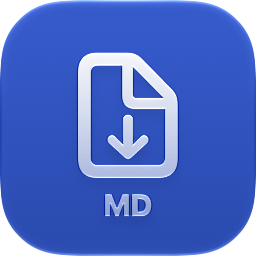
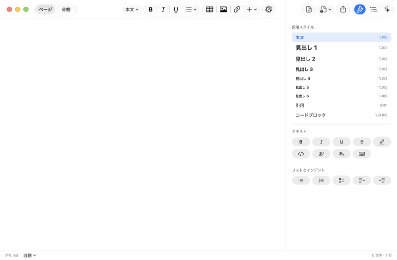
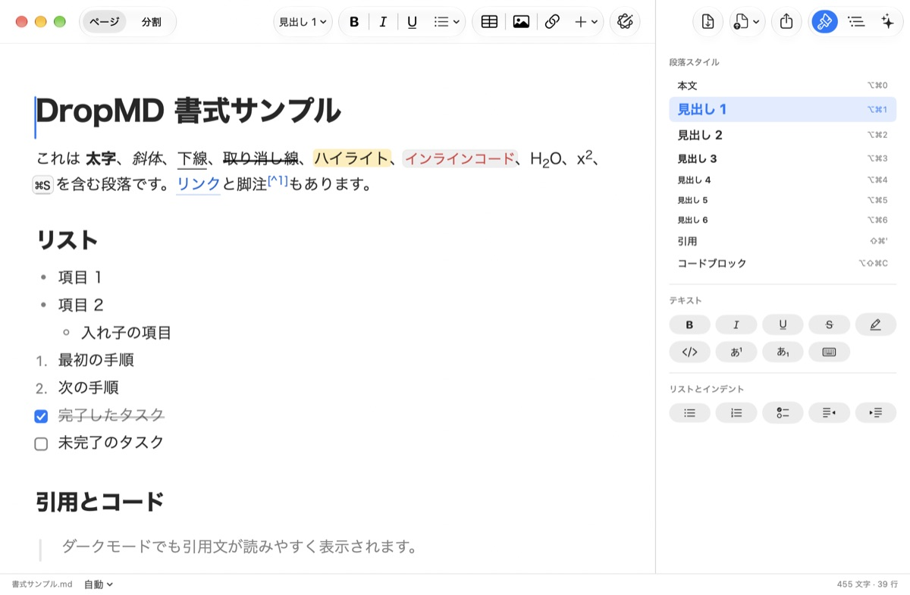
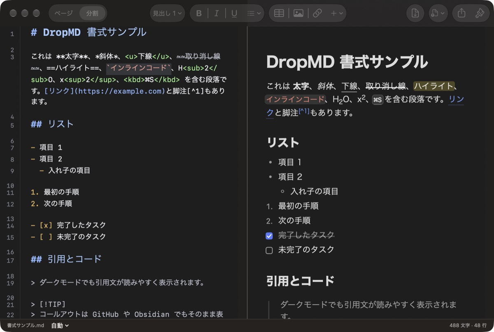
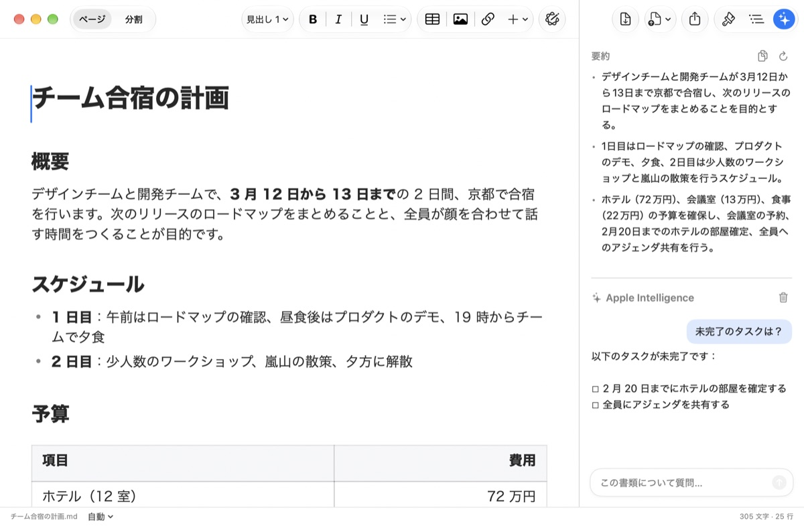

<p align="right">🌐 <a href="README.md">English</a> | <a href="README.zh-CN.md">简体中文</a> | <b>日本語</b></p>

<div lang="ja">

<div align="center">



# DropMD

**Mac 用のオフライン Markdown エディタ**

Word、Excel、PowerPoint、PDF などのファイルを Markdown に変換することもできます。すべてお使いの Mac 上で処理します

[](#-インストール) [](docs/发行说明.md) [](LICENSE) [](https://github.com/sponsors/Katsurama) [](https://www.patreon.com/c/katsurama/membership) [](https://afdian.com/a/katsurama) [](https://discord.gg/VUne62RvrJ)

<br>

📦 [**インストール**](#-インストール) &nbsp;·&nbsp; ✨ [機能](#-機能) &nbsp;·&nbsp; 🔄 [ファイル変換](#-ファイル変換) &nbsp;·&nbsp; 🔒 [プライバシー](#-プライバシー) &nbsp;·&nbsp; 🛠️ [ソースからビルド](#️-ソースからビルド) &nbsp;·&nbsp; 📖 [ユーザガイド（英語）](docs/User%20Guide.md) &nbsp;·&nbsp; 💬 [コミュニティ](#-コミュニティ)

<br>



</div>

</div>

> [!NOTE]
> 問題があれば Issues で報告するか、[Discord](https://discord.gg/VUne62RvrJ) で気軽に相談してください。
> 表示言語は Mac の言語設定に合わせて、日本語・英語・中国語（簡体字 / 繁体字）から自動で選ばれます。「DropMD → 設定…」で個別に選ぶこともできます。

<div lang="ja">

## ✨ 機能

<p align="center"> </p>

- **ページ表示**：Pages や Word のように、書式が付いた状態のまま直接編集できます。Markdown を知らなくても使え、ファイルは標準の Markdown で保存されます
- **分割表示**：左に行番号付きの Markdown ソース、右にページ表示。どちらでも直接編集でき、すぐに反映されます。スクロールも連動し、右側には左のカーソルがある段落が表示されます
- **よく使う書式**：見出し、太字、斜体、下線、取り消し線、ハイライト、リスト、チェックリスト、表、画像、リンク、コードブロック
- **その他の書式**：コールアウト（`> [!NOTE]`）、折りたたみセクション、脚注、数式、上付き / 下付き、キーボードのキー
- **目次**：「目次」パネルを開き、見出しをクリックするとその節へ移動します
- **画像**：GIF アニメはそのまま再生。画像を右クリックして「画像からテキストを抽出」を選ぶと、認識したテキストが画像の下に入ります
- **表と右クリックメニュー**：右クリックで行・列の挿入と削除、配置の設定。列の境目をドラッグして幅を変更。右クリックメニューには、リンク・画像・コードブロック・コールアウトに合わせたよく使う操作が並びます
- **文字サイズ**：「設定」で自動・大・中・小から選べます。「自動」はウインドウの幅に合わせて調整します
- **日本語・中国語・韓国語**：書類の言語を選ぶと、漢字がその言語の字形で表示されます（画面上でも、書き出したファイルでも）
- **クイックルック**：Finder で .md ファイルを選んでスペースキーを押すと、開かずに書式付きで確認できます
- **Mac ネイティブのアプリ**：SwiftUI で作られ、macOS 26 以降では Liquid Glass を使用。ライト / ダークの両方に合わせた配色です
- **書き出しと共有**：PDF・Word・HTML に対応。「共有」ボタンで AirDrop やメールでも送れます
- **自動保存とバージョン履歴**：編集中も自動で保存され、「ファイル → バージョン履歴 → すべてのバージョンを表示…」から Time Machine のような画面で過去の版を比較・復元できます
- **Siri とショートカット**：ショートカットから Markdown 書類の新規作成、テキストの追加、ファイルの Markdown への変換ができます。開いたことのある書類は Spotlight で見つかります
- **ソフトウェア・アップデート**：アプリ内で新しいバージョンを確認。ダウンロードしたファイルの完全性を確認したうえで、“再起動”を押すだけで更新できます

### 🆕 Apple Intelligence

<p align="center"></p>

Apple Intelligence に対応した Mac（macOS 26 以降）では、ツールバー右上の ✨ で右側のパネルを開けます。

- **要約**：書類全体（または選択した部分）を数個の要点にまとめます
- **書類について質問**：「未完了のタスクは？」のように聞くと、書類の内容をもとに答えます
- **変換と整理**：書式を保ったままの全文翻訳、表への変換、タスクの抽出、冒頭の属性（YAML）の生成
- **システムの作文ツールと翻訳**：作文ツールで校正や書き直しをしても、コードと数式はそのまま。「選択範囲を翻訳…」はシステムのオフライン翻訳で置き換えます。対応するシステムでは「スマート整形」と「画像を作成…」も使えます
- **この Mac とプライベートクラウド**：既定は「自動」。短い書類はこの Mac 上で、長い書類は Apple の Private Cloud Compute で処理できます。設定で「この Mac のみ」に変更できます

## 📦 インストール

1. [最新バージョン](../../releases/latest)を開き、ページ下部の **Assets** から `DropMD-macOS-AppleSilicon.dmg` だけをダウンロードします
   - `.zip` はアプリ内アップデート用、`.sha256` はチェックサムなので、ダウンロードは不要です
   - **Pre-release** と表示されているものはベータ版です。通常は必要ありません
2. 開いて **DropMD** を“アプリケーション”にドラッグします
3. 初めて開くときは macOS にブロックされます。下の方法で一度開けば、次からは聞かれません

Apple シリコン搭載の Mac、macOS 14 以降に対応しています。以降のバージョンはアプリ内からインストールできます（**DropMD → アップデートを確認…**）。

### Homebrew でインストール

```bash
brew tap katsurama/dropmd https://github.com/Katsurama/DropMD
brew install --cask katsurama/dropmd/dropmd
```

アップデートと完全アンインストール：

```bash
brew upgrade --cask katsurama/dropmd/dropmd         # 最新の安定版にアップデート
brew uninstall --zap --cask katsurama/dropmd/dropmd # 設定やキャッシュを含めてアンインストール
```

### 初回起動時の“Apple は検証できませんでした”

DropMD は無料のオープンソースソフトウェアで、有料の Apple デベロッパ証明書（年 99 ドル）で署名していないため、初めて開くと macOS が“‘DropMD’にマルウェアが含まれていないことを検証できませんでした”と表示します。これは DropMD に問題があるという意味ではありません。ソースコードはすべてこのリポジトリにあり、ダウンロード用のファイルは GitHub Actions で公開ビルドされ、各リリースには `.sha256` チェックサムが付いています。

**方法 1：システム設定で許可する（おすすめ）**

1. DropMD をダブルクリックし、メッセージが出たら **完了** をクリックします（“ゴミ箱に入れる”ではありません）
2. **システム設定 → プライバシーとセキュリティ** を開き、いちばん下までスクロールします
3. “セキュリティ”の下に“‘DropMD’はブロックされました”と表示されるので、横の **このまま開く** をクリックし、ログインパスワードを入力します
4. もう一度メッセージが出たら **このまま開く** をクリックします

**方法 2：ターミナルでコマンドを 1 つ実行する**

```bash
xattr -dr com.apple.quarantine /Applications/DropMD.app
```

これは、インターネットからダウンロードしたファイルに macOS が付ける印を外すだけです。以後はダブルクリックで開けます。

</div>

> [!NOTE]
> この操作は一度だけで構いません。アプリ内からインストールした新しいバージョンはブロックされません。

<div lang="ja">

## 🔄 ファイル変換

**ファイル → ファイルを Markdown に変換…** を選び、ファイルやフォルダごとドラッグします。まとめて変換され、ファイルごとに結果が表示されます。

| モード | 向いているもの | エンジン |
| --- | --- | --- |
| 高速 | Word、Excel、PowerPoint、HTML、テキストベースの PDF | [MarkItDown](https://github.com/microsoft/markitdown) |
| Word、レイアウト重視 | レイアウトや画像を残したい Word 文書 | [Pandoc](https://pandoc.org/) |
| 高精度 | 論文、表、数式、スキャンした PDF | [Docling](https://github.com/docling-project/docling) + OCR（RapidOCR、Apple Vision）、または [Xiaomi-OCR-0](https://github.com/xiaomi-research/Xiaomi-OCR-0) |

Python をインストールする必要はありません。変換エンジンはアプリに内蔵されています。

### 🆕 新機能：Xiaomi-OCR-0

高精度モードで [Xiaomi-OCR-0](https://github.com/xiaomi-research/Xiaomi-OCR-0) を選べるようになりました。Xiaomi（小米）がオープンソースで公開している文書認識モデルです（Apache-2.0）。「OCR エンジン」で選びます。初回は同意のうえ約 1.8 GB をダウンロードし、その後は完全にオフラインで動きます。

| | Xiaomi-OCR-0 | RapidOCR（標準） |
| --- | --- | --- |
| 文字認識 | より正確。数式と表も一緒に認識 | 普段使いには十分。数式は別のオプション |
| 複数の言語 | 中国語、日本語、英語、フランス語、ドイツ語、スペイン語、ロシア語。同じ行に混ざっていても可 | 中国語、日本語、英語 |
| 速さ（10 ページのテスト文書） | 約 155 秒 | 約 30 秒 |
| 追加のダウンロード | 約 1.8 GB | 不要 |
| PDF 内の画像 | 書き出さない | 書き出す |

</div>

> [!NOTE]
> 速さは M4 チップ、メモリ 16 GB の Mac で、きれいなテストページを使って測ったものです。実際のスキャンでは変わります。Xiaomi-OCR-0 は韓国語とベトナム語で誤字が多くなります。DropMD は独立したプロジェクトで、Xiaomi とは関係ありません。

<div lang="ja">

## 🔒 プライバシー

- ファイル変換はこの Mac 上で行い、元のファイルはアップロードも変更もしません。利用状況の収集や広告はありません。
- DropMD の書類向け AI 機能の既定は **自動** です。対応する Mac では、長い書類の処理に必要なテキストが Apple の Private Cloud Compute に送信される場合があり、利用できないときはこの Mac 上のモデルに切り替わります。「設定 → 一般 → Apple Intelligence」で **この Mac のみ** に変更できます。作文ツールなどのシステム機能は macOS が別途管理します。
- 高精度モード用の認識モデルのダウンロードやアップデートの確認でインターネットに接続する際は、同意を求めます。

## 🛠️ ソースからビルド

Apple シリコン搭載の Mac、Python 3.12、Xcode 26 以降が必要です。

```bash
pip install -r requirements.txt -r requirements-build.txt
pyinstaller packaging/dropmd.spec --noconfirm
tools/fetch_fonts.sh      # MiSans フォントをダウンロード（このリポジトリには含まれていません）
macos/build_app.sh        # dist/DropMD.app を出力
```

```bash
tools/test_codec.sh       # Markdown の往復テスト
tools/test_editor.sh      # ページ表示の編集テスト
tools/test_update.sh      # ソフトウェア・アップデートのインストールテスト
tools/test_l10n.sh        # すべての表示テキストに英語・日本語・繁体字の訳があるか確認
```

<details>
<summary>プロジェクトの構成</summary>

```
macos/                 インターフェイス（Swift / SwiftUI）
  Sources/DropMD/      エディタ、変換ウインドウ、ソフトウェア・アップデート
  Sources/DropMDQuickLook/  クイックルック用の拡張機能
  Resources/preview/   分割表示のプレビュー（markdown-it、KaTeX。同梱しており、Web からは読み込みません）
  Resources/ja.lproj/  日本語の表示テキスト（en.lproj：英語、zh-Hant.lproj：繁体字）
  Resources/AppIcon.icon  アプリのアイコン（Icon Composer 形式、ライト / ダークに対応）
  build_app.sh         DropMD.app を組み立てる
src/dropmd/            変換エンジン（Python：MarkItDown / Pandoc / Docling）
tools/                 テストスクリプト
.github/workflows/     .dmg のビルド、セルフテスト、リリース
docs/                  ユーザガイド、リリースノート、依存関係の一覧
```

Swift のインターフェイスは、アプリ内のローカルエンジン（標準入出力で JSON をやり取りする子プロセス）に変換を任せます。依存関係とバージョンは[依存関係の一覧](docs/依赖清单.md)（中国語）を参照してください。

</details>

## 💬 コミュニティ

<div align="center">
<p>テストへの参加、不具合の報告、ユーザー同士の交流はこちら</p>
<p><a href="https://discord.gg/VUne62RvrJ"></a></p>
</div>

## ☕ 支援

<div align="center">

DropMD がお役に立てたら、コーヒー一杯分の支援が今後の開発の励みになります ❤️

<a href="https://github.com/sponsors/Katsurama"></a><br><br>
<a href="https://www.patreon.com/c/katsurama/membership"></a><br><br>
<a href="https://afdian.com/a/katsurama"></a>

</div>

### 💖 スポンサー

まだスポンサーはいません。最初のサポーターをお待ちしています ☕

## 📄 ライセンス

[MIT](LICENSE) © 2026 DropMD contributors。サードパーティのライセンスは [THIRD_PARTY_LICENSES.md](THIRD_PARTY_LICENSES.md) と、アプリの **ヘルプ → オープンソースライセンス** にあります。

</div>
