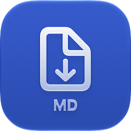
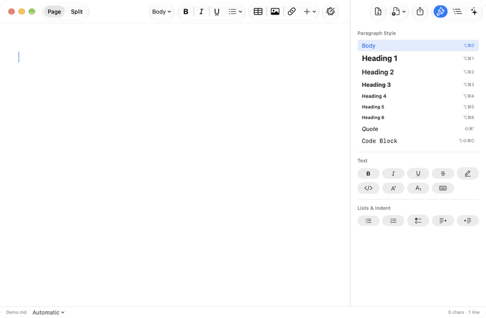
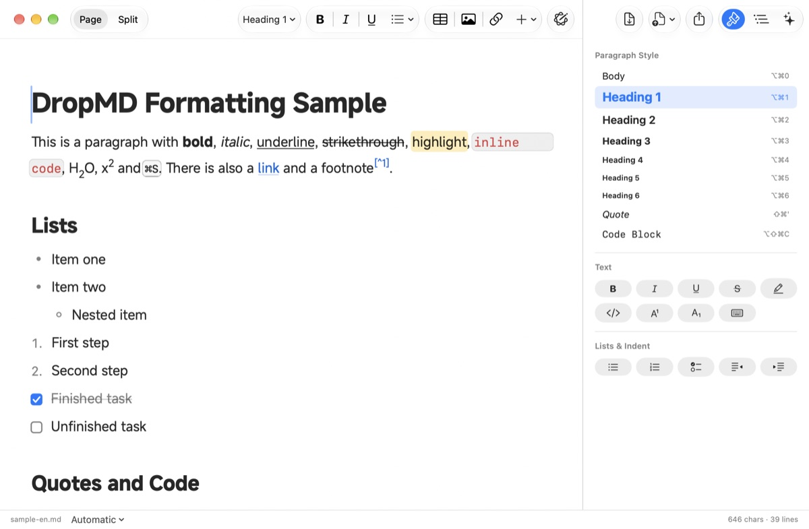
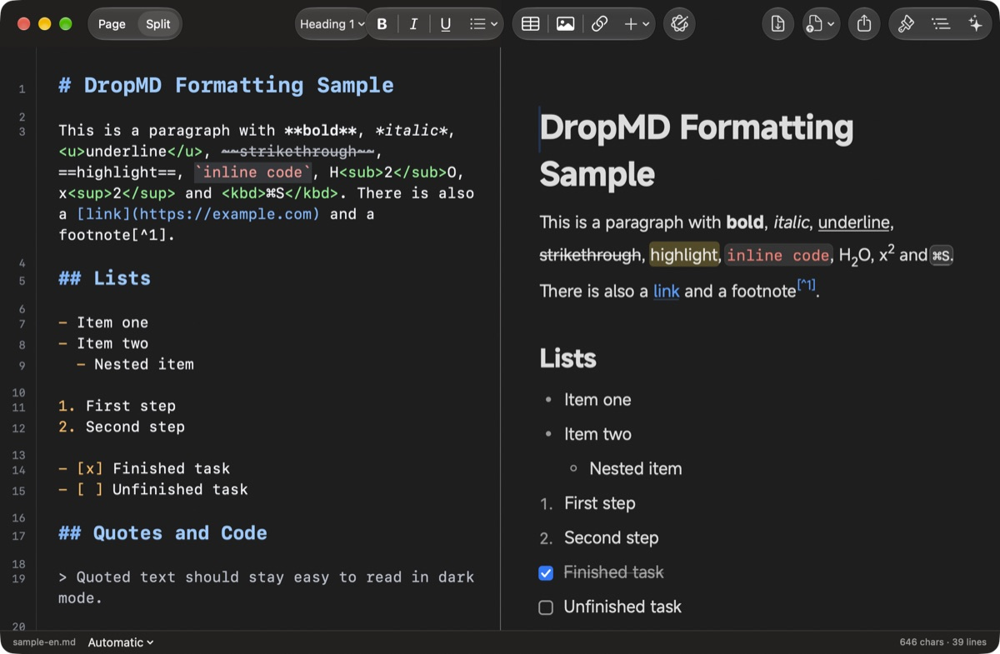
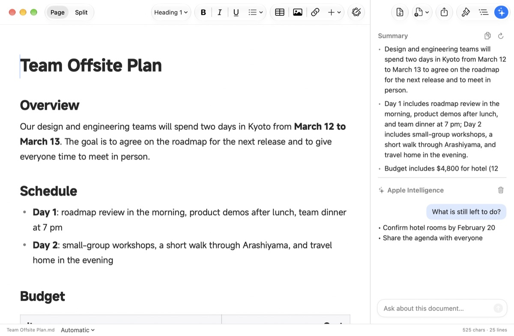

<p align="right">🌐 <b>English</b> | <a href="README.zh-CN.md">简体中文</a> | <a href="README.ja.md">日本語</a></p>

<div align="center">



# DropMD

**An offline Markdown editor for the Mac**

It also converts Word, Excel, PowerPoint, PDF and other files to Markdown, all on your own Mac

[](#-install) [](docs/发行说明.md) [](LICENSE) [](https://github.com/sponsors/Katsurama) [](https://www.patreon.com/c/katsurama/membership) [](https://afdian.com/a/katsurama) [](https://discord.gg/VUne62RvrJ)

<br>

📦 [**Install**](#-install) &nbsp;·&nbsp; ✨ [Features](#-features) &nbsp;·&nbsp; 🔄 [File conversion](#-file-conversion) &nbsp;·&nbsp; 🔒 [Privacy](#-privacy) &nbsp;·&nbsp; 🛠️ [Build from source](#️-build-from-source) &nbsp;·&nbsp; 📖 [User Guide](docs/User%20Guide.md) &nbsp;·&nbsp; 💬 [Community](#-community)

<br>



</div>

> [!NOTE]
> Please report problems in Issues, or come chat with us on [Discord](https://discord.gg/VUne62RvrJ).
> The interface follows your Mac's language: English, Japanese, or Simplified / Traditional Chinese. You can also choose one in DropMD → Settings…

## ✨ Features

<p align="center"> </p>

- **Page view**: edit the formatted document directly, like in Pages or Word. You don't need to know Markdown, and the file is still saved as standard Markdown
- **Split view**: Markdown source on the left, Page view on the right; edit either side and the other updates right away. Both sides scroll together, and the right side marks the paragraph your cursor is in
- **Everyday formatting**: headings, bold, italic, underline, strikethrough, highlight, lists, checklists, tables, images, links, code blocks
- **More formatting**: callouts (`> [!NOTE]`), collapsible sections, footnotes, math formulas, superscript / subscript, keyboard keys
- **Tables and the context menu**: right-click to insert or delete rows and columns and set alignment; drag a column edge to resize; the context menu offers common actions for links, images, code blocks and callouts
- **Chinese, Japanese and Korean text**: choose the document language so characters use the right glyph shapes, on screen and in exported files
- **A native Mac app**: built with SwiftUI, uses Liquid Glass on macOS 26 and later, with colors designed for both light and dark mode
- **Quick Look**: select a .md file in Finder and press Space to see it formatted without opening it
- **Export and share**: PDF, Word and HTML, or send the file via AirDrop or Mail with the Share button
- **Auto save & version history**: changes are saved automatically; choose **File → Version History → Browse All Versions…** to open a Time Machine-style viewer to compare and restore any earlier version
- **Software updates**: check for new versions in the app; downloads are checked for integrity, then click Restart to finish

### 🆕 Apple Intelligence

<p align="center"></p>

On Macs that support Apple Intelligence (macOS 26 or later), click ✨ at the top right of the toolbar to open the side pane:

- **Summary**: sums up the whole document (or the selected text) in a few bullet points
- **Ask about this document**: ask things like “What is still left to do?” and get answers based on the document
- **Writing tools**: translate the whole document while keeping its formatting, turn text into a table, pull out a task list, or generate front matter (YAML)
- **On-device or private cloud**: the default is Automatic — short documents stay on this Mac, and long ones can use Apple Private Cloud Compute. You can switch to On-Device Only in Settings

## 📦 Install

1. Open the [latest release](../../releases/latest) and, under **Assets** at the bottom, download only `DropMD-macOS-AppleSilicon.dmg`
   - The `.zip` is for in-app updates and the `.sha256` files are checksums; you don't need them
   - Releases marked **Pre-release** are betas; most people don't need them
2. Open it and drag **DropMD** to Applications
3. macOS blocks it the first time you open it. Open it once as described below and you won't be asked again

For Macs with Apple silicon, macOS 14 or later. Later versions can be installed from inside the app (**DropMD → Check for Updates…**).

### Install with Homebrew

```bash
brew tap katsurama/dropmd https://github.com/Katsurama/DropMD
brew install --cask katsurama/dropmd/dropmd
```

Upgrade or completely uninstall:

```bash
brew upgrade --cask katsurama/dropmd/dropmd         # Update to the latest stable release
brew uninstall --zap --cask katsurama/dropmd/dropmd # Uninstall and remove all preferences and caches
```

### First launch: “Apple could not verify…”

DropMD is free, open source software and isn't signed with a paid Apple developer certificate ($99 a year), so the first time you open it macOS says “Apple could not verify ‘DropMD’ is free of malware”. This doesn't mean anything is wrong with it: all the source code is in this repository, the downloads are built in public by GitHub Actions, and every release comes with a `.sha256` checksum.

**Option 1: allow it in System Settings (recommended)**

1. Double-click DropMD. When the message appears, click **Done** (not “Move to Trash”)
2. Open **System Settings → Privacy & Security** and scroll to the bottom
3. Under “Security” you'll see “‘DropMD’ was blocked”. Click **Open Anyway** next to it and enter your login password
4. When the message appears again, click **Open Anyway**

**Option 2: run one command in Terminal**

```bash
xattr -dr com.apple.quarantine /Applications/DropMD.app
```

This only removes the mark macOS puts on files downloaded from the internet. After that, DropMD opens with a double-click.

> [!NOTE]
> You only need to do this once. New versions installed from inside the app aren't blocked.

## 🔄 File conversion

Choose **File → Convert Files to Markdown…**, then drag in files or whole folders. They are converted in one go, with a result for each file.

| Mode | Good for | Engine |
| --- | --- | --- |
| Fast | Word, Excel, PowerPoint, HTML, text-based PDF | [MarkItDown](https://github.com/microsoft/markitdown) |
| Word, better layout | Word documents whose layout and images should be kept | [Pandoc](https://pandoc.org/) |
| High Accuracy | Papers, tables, formulas, scanned PDFs | [Docling](https://github.com/docling-project/docling) + OCR (RapidOCR, Apple Vision), or [Xiaomi-OCR-0](https://github.com/xiaomi-research/Xiaomi-OCR-0) |

You don't need to install Python: the conversion engine is built into the app.

### 🆕 New: Xiaomi-OCR-0

High Accuracy mode can now use [Xiaomi-OCR-0](https://github.com/xiaomi-research/Xiaomi-OCR-0), an open source document recognition model from Xiaomi (Apache-2.0). Choose it under OCR Engine. The first time, it downloads about 1.8 GB after you agree; after that it works fully offline.

| | Xiaomi-OCR-0 | RapidOCR (default) |
| --- | --- | --- |
| Text | More accurate; reads formulas and tables too | Fine for everyday use; formulas are a separate option |
| Mixed languages | Chinese, Japanese, English, French, German, Spanish, Russian, even on one line | Chinese, Japanese, English |
| Speed (10-page test document) | About 155 seconds | About 30 seconds |
| Extra download | About 1.8 GB | None |
| Images in the PDF | Not exported | Exported |

> [!NOTE]
> Speed was measured on an M4 Mac with 16 GB of memory using clean test pages; real scans will differ. Xiaomi-OCR-0 makes more mistakes in Korean and Vietnamese. DropMD is an independent project and isn't affiliated with Xiaomi.

## 🔒 Privacy

- File conversion runs on this Mac without uploading or modifying the source files. DropMD has no analytics or ads.
- DropMD’s document AI features default to **Automatic**: on supported Macs, relevant text from long documents may be sent to Apple Private Cloud Compute, and DropMD falls back to the on-device model when the cloud model is unavailable. You can switch to **On-Device Only** in Settings → General → Apple Intelligence. System features such as Writing Tools are managed separately by macOS.
- DropMD asks for your consent to download the High Accuracy recognition models or check for updates online.

## 🛠️ Build from source

You need a Mac with Apple silicon, Python 3.12 and Xcode 26 or later.

```bash
pip install -r requirements.txt -r requirements-build.txt
pyinstaller packaging/dropmd.spec --noconfirm
tools/fetch_fonts.sh      # download the MiSans font (not stored in this repository)
macos/build_app.sh        # outputs dist/DropMD.app
```

```bash
tools/test_codec.sh       # Markdown round-trip tests
tools/test_editor.sh      # Page view editing tests
tools/test_update.sh      # software update install tests
tools/test_l10n.sh        # checks every interface text has English, Japanese and Traditional Chinese translations
```

<details>
<summary>Project layout</summary>

```
macos/                 Interface (Swift / SwiftUI)
  Sources/DropMD/      Editor, converter window, software updates
  Sources/DropMDQuickLook/  Quick Look extension
  Resources/preview/   Split view preview (markdown-it, KaTeX; bundled, nothing loaded from the web)
  Resources/en.lproj/  English interface text (ja.lproj: Japanese, zh-Hant.lproj: Traditional Chinese)
  Resources/AppIcon.icon  App icon (Icon Composer format, adapts to light / dark)
  build_app.sh         Assembles DropMD.app
src/dropmd/            Conversion engine (Python: MarkItDown / Pandoc / Docling)
tools/                 Test scripts
.github/workflows/     Builds the .dmg, self-tests, releases
docs/                  User guides, release notes, dependency list
```

The Swift interface hands conversions to the local engine inside the app (a child process that exchanges JSON over standard input and output). For dependencies and versions, see the [dependency list](docs/依赖清单.md) (in Chinese).

</details>

## 💬 Community

<div align="center">
<p>Join the beta, report problems, and chat with other users</p>
<p><a href="https://discord.gg/VUne62RvrJ"></a></p>
</div>

## ☕ Support

<div align="center">

If DropMD helps you, a coffee keeps the updates coming ❤️

<a href="https://github.com/sponsors/Katsurama"></a><br><br>
<a href="https://www.patreon.com/c/katsurama/membership"></a><br><br>
<a href="https://afdian.com/a/katsurama"></a>

</div>

### 💖 Sponsors

No sponsors yet. Be the first ☕

## 📄 License

[MIT](LICENSE) © 2026 DropMD contributors. Third-party licenses are in [THIRD_PARTY_LICENSES.md](THIRD_PARTY_LICENSES.md), and in the app under **Help → Open Source Licenses**.
