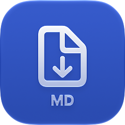
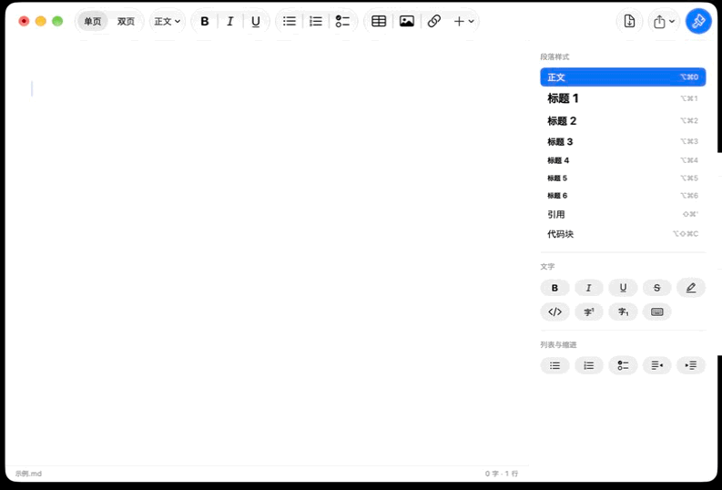
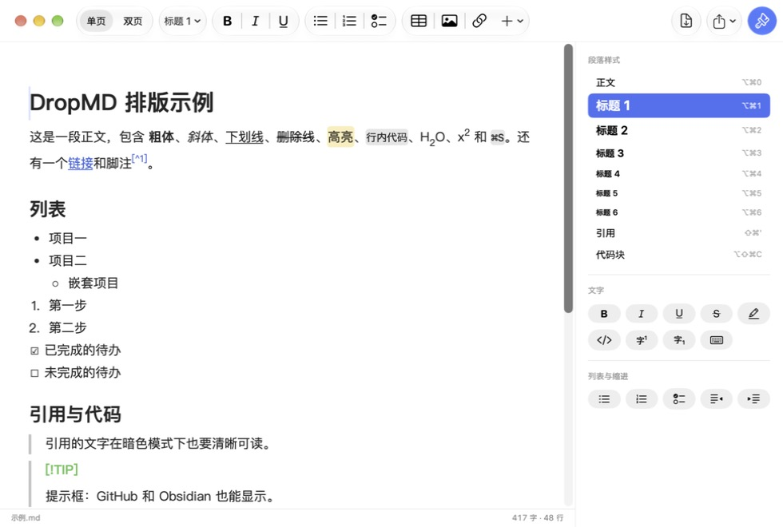
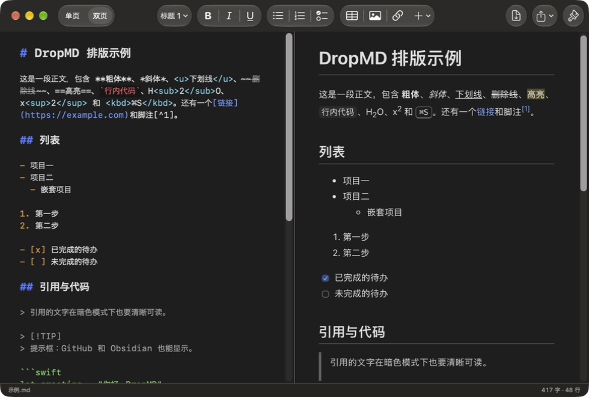

<div align="center">



# DropMD

**Mac 上的离线 Markdown 编辑器**

还能把 Word、Excel、PowerPoint、PDF 等文件转换为 Markdown，全部在本机完成

[](#-安装) [](docs/发行说明.md) [](macos) [](LICENSE)

[**安装**](#-安装) · [功能](#-功能) · [文件转换](#-文件转换) · [隐私](#-隐私) · [从源码构建](#️-从源码构建) · [使用说明](docs/使用说明.md)



</div>

> [!NOTE]
> 当前是测试版。有问题请在 Issues 里反馈。

## ✨ 功能

<p align="center"> </p>

- **单页**：像 Pages / Word 一样直接排版，不用会写 Markdown，保存的仍是标准 Markdown 文件
- **双页**：左边 Markdown 原文，右边实时预览，滚动同步
- **常用格式**：标题、粗体、斜体、下划线、删除线、高亮、列表、待办、表格、图片、链接、代码块
- **更多格式**：提示框（`> [!NOTE]`）、折叠块、脚注、数学公式、上标 / 下标、键盘按键
- **中文输入法友好**：段首输入“－ ”“》 ”“1。 ”“【】 ”“＃ ”也能自动变成列表、引用、待办、标题
- **原生 Mac 界面**：SwiftUI 开发，macOS 26 起使用 Liquid Glass，浅色 / 深色都有专门配色
- **导出**：PDF、HTML；自动保存和版本历史
- **软件更新**：在 App 里检查新版本，下载后校验完整性，点“重新启动”即完成

## 📦 安装

1. 在 [Releases](../../releases) 下载 `DropMD-macOS-AppleSilicon.dmg`
2. 打开后把 **DropMD** 拖到“应用程序”
3. 第一次打开会被系统拦下，按下面的方法打开一次，以后就不会再提示

适用于 Apple 芯片的 Mac，macOS 14 及以上。以后的新版本在 App 里更新即可（**DropMD → 检查更新…**）。

### 第一次打开：提示“无法验证开发者”怎么办

DropMD 是免费的开源软件，没有购买苹果的开发者签名（每年 99 美元），所以 macOS 第一次打开时会提示“Apple 无法验证‘DropMD’是否包含恶意软件”。这不代表软件有问题：全部源码都在这个仓库里，安装包由 GitHub Actions 公开构建，每个版本都附带 `.sha256` 校验值。

**方法一：在系统设置里放行（推荐）**

1. 双击打开 DropMD，看到提示后点 **完成**（不要点“移到废纸篓”）
2. 打开 **系统设置 → 隐私与安全性**，拉到最下面
3. 在“安全性”一栏会看到“已阻止使用‘DropMD’”，点旁边的 **仍要打开**，输入开机密码
4. 再次弹出提示时，点 **仍要打开**

**方法二：在“终端”里运行一行命令**

```bash
xattr -dr com.apple.quarantine /Applications/DropMD.app
```

这行命令只是去掉系统给“从网上下载的文件”加的标记，之后双击就能直接打开。

> [!NOTE]
> 只需要做一次。之后在 App 内更新的新版本不会再被拦下。


## 🔄 文件转换

菜单 **文件 → 转换文件为 Markdown…**，拖入文件或整个文件夹，批量转换，逐个显示结果。

| 模式 | 适合 | 引擎 |
| --- | --- | --- |
| 快速 | Word、Excel、PowerPoint、HTML、文字型 PDF | [MarkItDown](https://github.com/microsoft/markitdown) |
| Word 高质量 | 需要还原排版和图片的 Word 文档 | [Pandoc](https://pandoc.org/) |
| 高精度 | 论文、表格、公式、扫描版 PDF | [Docling](https://github.com/docling-project/docling) + OCR（RapidOCR 或 Apple Vision） |

不需要安装 Python，转换引擎已经打包在 App 里。

## 🔒 隐私

- 所有编辑和转换都在这台 Mac 上完成，文件不会上传
- 只在你同意时联网：下载高精度模式的识别模型、检查更新
- 没有统计、没有广告，不修改原始文件

## 🛠️ 从源码构建

需要 Apple 芯片的 Mac、Python 3.12 和 Xcode 26 以上。

```bash
pip install -r requirements.txt -r requirements-build.txt
pyinstaller packaging/dropmd.spec --noconfirm
macos/build_app.sh        # 输出 dist/DropMD.app
```

```bash
tools/test_codec.sh       # Markdown 往返测试
tools/test_editor.sh      # 单页编辑器按键测试
tools/test_update.sh      # 软件更新的安装测试
```

<details>
<summary>项目结构</summary>

```
macos/                 界面（Swift / SwiftUI）
  Sources/DropMD/      编辑器、文件转换窗口、软件更新
  Resources/preview/   双页预览（markdown-it、KaTeX，随源码提供，不联网加载）
  Resources/AppIcon.icon  App 图标（Icon Composer 格式，自动适配浅色 / 深色）
  build_app.sh         组装 DropMD.app
src/dropmd/            转换引擎（Python：MarkItDown / Pandoc / Docling）
tools/                 测试脚本
.github/workflows/     构建 .dmg、自检、发布
docs/                  使用说明、发行说明、依赖清单
```

Swift 界面把转换任务交给 App 里的本机引擎（子进程，通过标准输入输出交换 JSON）。依赖及版本见 [依赖清单](docs/依赖清单.md)。

</details>

## 📄 许可证

[MIT](LICENSE) © 2026 DropMD contributors。第三方组件的许可证见 [THIRD_PARTY_LICENSES.md](THIRD_PARTY_LICENSES.md)，在 App 的 **帮助 → 开源许可** 中也能查看。
