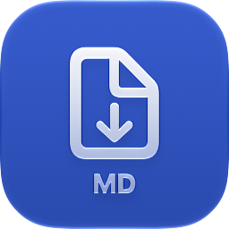
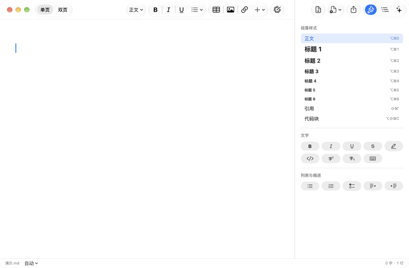
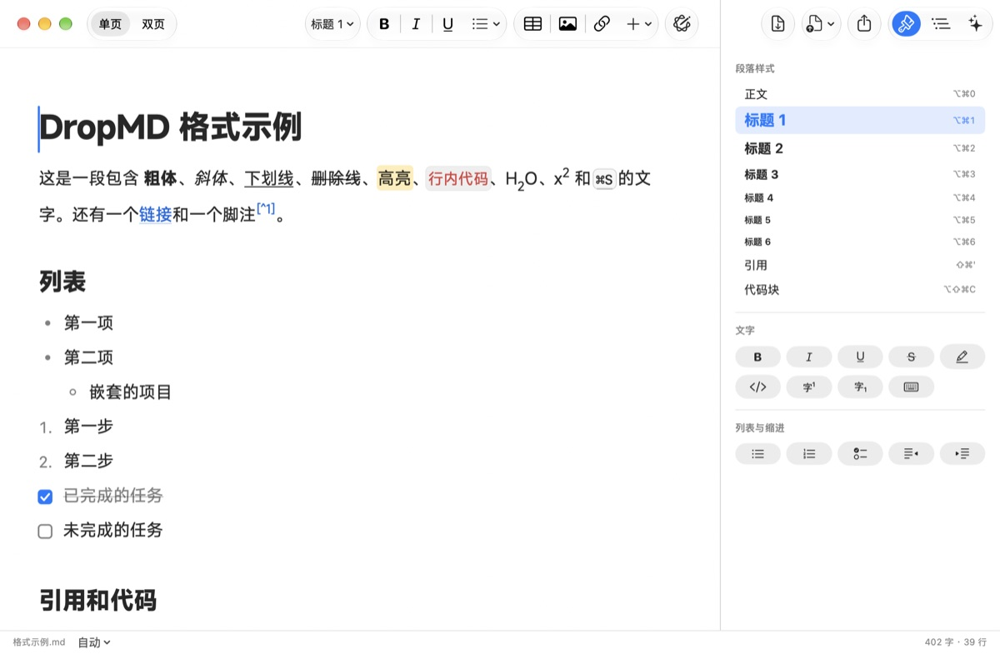
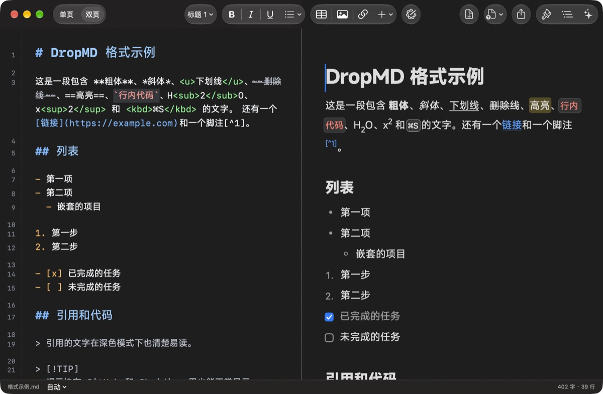
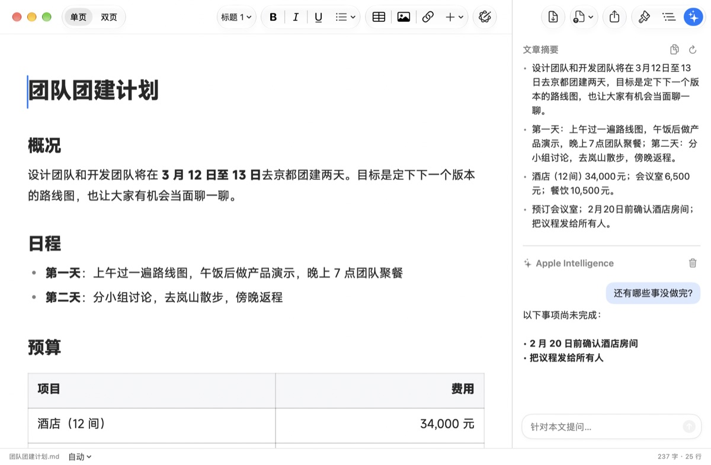
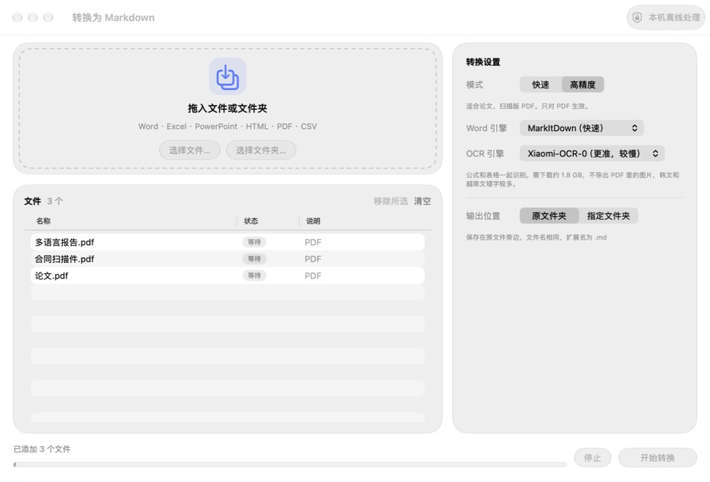
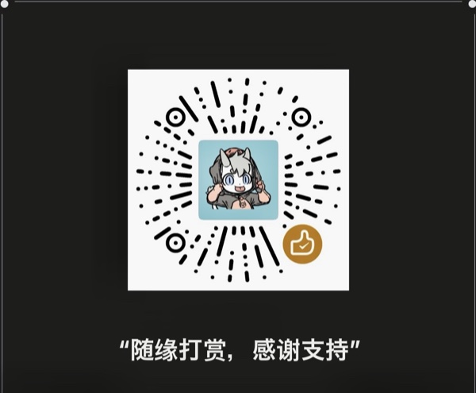

<p align="right">🌐 <a href="README.md">English</a> | <b>简体中文</b> | <a href="README.ja.md">日本語</a></p>

<div align="center">



# DropMD

**Mac 上的离线 Markdown 编辑器**

还能把 Word、Excel、PowerPoint、PDF 等文件转换为 Markdown，全部在本机完成

[](#-安装) [](docs/发行说明.md) [](LICENSE) [](https://github.com/sponsors/Katsurama) [](https://afdian.com/a/katsurama) [](https://discord.gg/VUne62RvrJ) [](https://qun.qq.com/universal-share/share?ac=1&authKey=mbUgS60nnSzR2inccSoO%2BM4r%2BNMmccWLqCLkRWF%2F3aaEx%2FCX30Fizgha%2Fo6qaAvV&busi_data=eyJncm91cENvZGUiOiIxMTI1ODkzNTA0IiwidG9rZW4iOiJkQ1NySUpoeCtmTUlrV3JUWUN5SFZqNU5wZllLa2lFLzFrUjZMKzdnaXV0eUM1R001ZzMzb1ZFOXNTbFNudFVPIiwidWluIjoiMzI0MzY3NzM1MiJ9&data=AJTczm17mcBKqj3VXo3mcTEzkLtb9_ozC8vIN86Zcm8p_2cQJ63-BoTHLDlRXXAZ9OTuDjY1Rqekn1E_zbQZfA&svctype=4&tempid=h5_group_info)

<br>

📦 [**安装**](#-安装) &nbsp;·&nbsp; ✨ [功能](#-功能) &nbsp;·&nbsp; 🔄 [文件转换](#-文件转换) &nbsp;·&nbsp; 🔒 [隐私](#-隐私) &nbsp;·&nbsp; 🛠️ [从源码构建](#️-从源码构建) &nbsp;·&nbsp; 📖 [使用说明](docs/使用说明.md) &nbsp;·&nbsp; 💬 [交流](#-交流)

<br>



<br>

[](https://www.bilibili.com/video/BV1pTxQ6SEP4)

</div>

> [!NOTE]
> 有问题请在 [Issues](../../issues) 里反馈，或到下方[交流](#-交流)加入 QQ 群和 Discord。

## ✨ 功能

<p align="center"> </p>

- **单页**：像 Pages / Word 一样直接排版，不用会写 Markdown，保存的仍是标准 Markdown 文件
- **双页**：左边 Markdown 原文（带行号），右边是单页，两边都能直接改、实时同步；滚动一起走，右边会标出左边光标所在的那一段
- **常用格式**：标题、粗体、斜体、下划线、删除线、高亮、列表、待办、表格、图片、链接、代码块
- **更多格式**：提示框（`> [!NOTE]`）、折叠块、脚注、数学公式、上标 / 下标、键盘按键
- **目录**：点标题跳到对应位置
- **图片**：GIF 自动播放，右键可提取图中文字
- **表格和右键菜单**：右键插入、删除行和列，设置对齐；拖动列边界调整列宽；右键菜单按点中的内容（链接、图片、代码块、提示框）给出常用操作
- **字号**：自动、大、中、小
- **界面语言**：简体中文、繁体中文、英文或日文，跟随系统，也可以在“设置”里单独选择
- **中文输入法友好**：段首输入“－ ”“》 ”“1。 ”“【】 ”“＃ ”也能自动变成列表、引用、待办、标题
- **原生 Mac 界面**：SwiftUI 开发，macOS 26 起使用 Liquid Glass，浅色 / 深色都有专门配色
- **文件转换**：Word、Excel、PowerPoint、PDF 转成 Markdown；扫描版 PDF 可选 [Xiaomi-OCR-0](#-新接入xiaomi-ocr-0) 识别 🆕
- **快速查看**：在访达里选中 .md 文件按空格，不用打开就能看到排版效果
- **导出和分享**：PDF、Word、HTML，或用“分享”按钮通过隔空投送、邮件发送
- **历史版本**：自动保存，随时翻看并恢复以前的版本
- **快捷指令**：新建文档、追加文字、转换文件
- **软件更新**：在 App 里检查新版本，下载后校验完整性，点“重新启动”即完成

### Apple 智能

<p align="center"></p>

- **文章摘要**：把全文或选中的段落归纳成几条要点
- **针对本文提问**：按文档内容回答问题
- **写作工具**：翻译整篇文档、整理成表格、提取待办

## 📦 安装

1. 打开[最新版本](../../releases/latest)，在页面下方的 **Assets** 里只下载 `DropMD-macOS-AppleSilicon.dmg`
   - `.zip` 是给 App 内更新用的，`.sha256` 是校验值，都不用下
   - 标着 **Pre-release** 的是测试版，一般用户不用装
2. 打开后把 **DropMD** 拖到右边的 **Applications**（应用程序）文件夹
3. 第一次打开会被系统拦下，按下面的方法打开一次，以后就不会再提示

适用于 Apple 芯片的 Mac，macOS 14 及以上。以后的新版本在 App 里更新即可（**DropMD → 检查更新…**）。

### 通过 Homebrew 安装

```bash
brew tap katsurama/dropmd https://github.com/Katsurama/DropMD
brew install --cask katsurama/dropmd/dropmd
```

更新与彻底卸载：

```bash
brew upgrade --cask katsurama/dropmd/dropmd         # 更新到最新正式版
brew uninstall --zap --cask katsurama/dropmd/dropmd # 卸载并清理全部配置与缓存
```

### 第一次打开：提示“无法验证开发者/文件已损坏”怎么办

DropMD 是免费的开源软件，没有购买苹果的开发者签名（每年 99 美元），所以 macOS 第一次打开时会提示“Apple 无法验证‘DropMD’是否包含恶意软件”。这不代表软件有问题：全部源码都在这个仓库里，安装包由 GitHub Actions 公开构建，每个版本都附带 `.sha256` 校验值。

**方法一：在系统设置里放行（推荐）**

1. 双击打开 DropMD，看到提示后点 **完成**（不要点“移到废纸篓”）
2. 打开 **系统设置 → 隐私与安全性**，拉到最下面
3. 在“安全性”一栏会看到“已阻止使用‘DropMD’”，点旁边的 **仍要打开**，输入开机密码
4. 再次弹出提示时，点 **仍要打开**

**方法二：在“终端”里运行一行命令**

```bash
xattr -dr com.apple.quarantine /Applications/DropMD.app
```

这行命令只是去掉系统给“从网上下载的文件”加的标记，之后双击就能直接打开。

> [!NOTE]
> 只需要做一次。之后在 App 内更新的新版本不会再被拦下。

## 🔄 文件转换

菜单 **文件 → 转换文件为 Markdown…**，拖入文件或整个文件夹，批量转换，逐个显示结果。

| 模式 | 适合 | 引擎 |
| --- | --- | --- |
| 快速 | Word、Excel、PowerPoint、HTML、文字型 PDF | [MarkItDown](https://github.com/microsoft/markitdown) |
| Word 高质量 | 需要还原排版和图片的 Word 文档 | [Pandoc](https://pandoc.org/) |
| 高精度 | 论文、表格、公式、扫描版 PDF | [Docling](https://github.com/docling-project/docling) + OCR（RapidOCR、Apple Vision），或 [Xiaomi-OCR-0](https://github.com/xiaomi-research/Xiaomi-OCR-0) |

不需要安装 Python，转换引擎已经打包在 App 里。

### 🆕 新接入：Xiaomi-OCR-0

<p align="center"></p>

高精度模式现在可以选 [Xiaomi-OCR-0](https://github.com/xiaomi-research/Xiaomi-OCR-0)：小米开源的文档识别模型（Apache-2.0）。在“OCR 引擎”里选它，第一次用时同意后下载约 1.8 GB，之后完全离线。

| | Xiaomi-OCR-0 | RapidOCR（默认） |
| --- | --- | --- |
| 认字 | 更准，公式和表格一起识别 | 日常够用，公式要另外打开 |
| 多语言混排 | 中、日、繁、英、法、德、西、俄，写在同一行也能认 | 中、日、繁、英 |
| 速度（10 页测试文档） | 约 155 秒 | 约 30 秒 |
| 额外下载 | 约 1.8 GB | 不用 |
| PDF 里的图片 | 不导出 | 导出 |

> [!NOTE]
> 速度是在 M4 芯片、16 GB 内存的 Mac 上用干净的测试页测的，真实扫描件会有出入。Xiaomi-OCR-0 认韩文和越南文错字较多。DropMD 是独立项目，与小米没有关联。

## 🔒 隐私

- 编辑和转换都在这台 Mac 上完成，文件不会上传
- Apple 智能处理长文档时可能用 Apple 私有云计算，可在设置里改为“仅本机”
- 只在你同意时联网：下载识别模型、检查更新；没有统计、没有广告

## 🛠️ 从源码构建

需要 Apple 芯片的 Mac、Python 3.12 和 Xcode 26 以上。

```bash
pip install -r requirements.txt -r requirements-build.txt
pyinstaller packaging/dropmd.spec --noconfirm
tools/fetch_fonts.sh      # 下载 MiSans 字体（不放在仓库中）
macos/build_app.sh        # 输出 dist/DropMD.app
```

```bash
tools/test_codec.sh       # Markdown 往返测试
tools/test_editor.sh      # 单页编辑器按键测试
tools/test_update.sh      # 软件更新的安装测试
tools/test_l10n.sh        # 检查界面文字是否都有英文、日文、繁体译文
```

<details>
<summary>项目结构</summary>

```
macos/                 界面（Swift / SwiftUI）
  Sources/DropMD/      编辑器、文件转换窗口、软件更新
  Sources/DropMDQuickLook/  快速查看（Quick Look）扩展
  Resources/preview/   双页预览（markdown-it、KaTeX，随源码提供，不联网加载）
  Resources/en.lproj/  英文界面文字（ja.lproj：日文，zh-Hant.lproj：繁体）
  Resources/AppIcon.icon  App 图标（Icon Composer 格式，自动适配浅色 / 深色）
  build_app.sh         组装 DropMD.app
src/dropmd/            转换引擎（Python：MarkItDown / Pandoc / Docling）
tools/                 测试脚本
.github/workflows/     构建 .dmg、自检、发布
docs/                  使用说明（简体、繁体、英文、日文）、发行说明、依赖清单
```

Swift 界面把转换任务交给 App 里的本机引擎（子进程，通过标准输入输出交换 JSON）。依赖及版本见 [依赖清单](docs/依赖清单.md)。

</details>

## 💬 交流

<div align="center">
<p>参与测试、反馈问题与交流</p>
<p><a href="https://qun.qq.com/universal-share/share?ac=1&authKey=mbUgS60nnSzR2inccSoO%2BM4r%2BNMmccWLqCLkRWF%2F3aaEx%2FCX30Fizgha%2Fo6qaAvV&busi_data=eyJncm91cENvZGUiOiIxMTI1ODkzNTA0IiwidG9rZW4iOiJkQ1NySUpoeCtmTUlrV3JUWUN5SFZqNU5wZllLa2lFLzFrUjZMKzdnaXV0eUM1R001ZzMzb1ZFOXNTbFNudFVPIiwidWluIjoiMzI0MzY3NzM1MiJ9&data=AJTczm17mcBKqj3VXo3mcTEzkLtb9_ozC8vIN86Zcm8p_2cQJ63-BoTHLDlRXXAZ9OTuDjY1Rqekn1E_zbQZfA&svctype=4&tempid=h5_group_info"></a></p>
<p><a href="https://qun.qq.com/universal-share/share?ac=1&authKey=mbUgS60nnSzR2inccSoO%2BM4r%2BNMmccWLqCLkRWF%2F3aaEx%2FCX30Fizgha%2Fo6qaAvV&busi_data=eyJncm91cENvZGUiOiIxMTI1ODkzNTA0IiwidG9rZW4iOiJkQ1NySUpoeCtmTUlrV3JUWUN5SFZqNU5wZllLa2lFLzFrUjZMKzdnaXV0eUM1R001ZzMzb1ZFOXNTbFNudFVPIiwidWluIjoiMzI0MzY3NzM1MiJ9&data=AJTczm17mcBKqj3VXo3mcTEzkLtb9_ozC8vIN86Zcm8p_2cQJ63-BoTHLDlRXXAZ9OTuDjY1Rqekn1E_zbQZfA&svctype=4&tempid=h5_group_info"></a> &nbsp; <a href="https://discord.gg/VUne62RvrJ"></a></p>
</div>

## ☕ 支持作者

<div align="center">

如果 DropMD 帮到了你，欢迎请我喝杯咖啡，你的支持会让我继续更新下去 ❤️

<a href="https://github.com/sponsors/Katsurama"></a><br><br>
<a href="https://afdian.com/a/katsurama"></a><br><br>

或者用微信扫码赞赏



</div>

### 💖 赞助者

还没有赞助者，欢迎成为第一位 ☕

## 📄 许可证

[MIT](LICENSE) © 2026 DropMD contributors。第三方组件的许可证见 [THIRD_PARTY_LICENSES.md](THIRD_PARTY_LICENSES.md)，在 App 的 **帮助 → 开源许可** 中也能查看。
